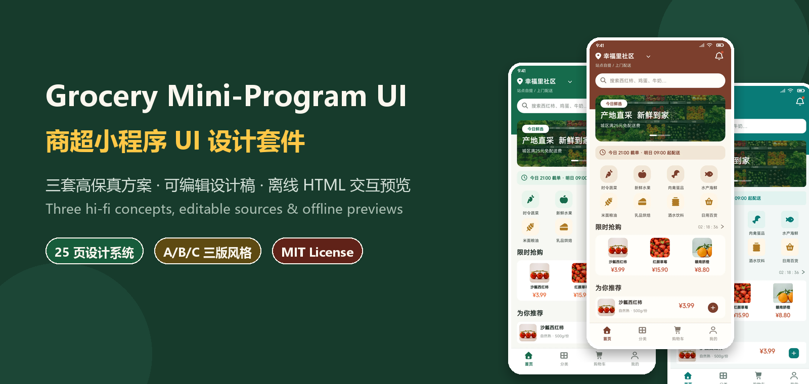
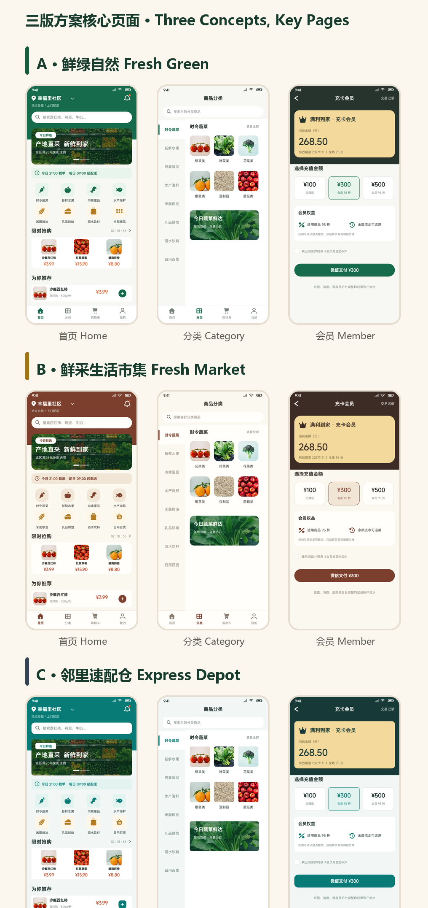

# Grocery Mini-Program UI · 商超小程序 UI 设计

[简体中文](README.zh-CN.md) | English



A Kimi plugin that designs **three genuinely different high-fidelity UI concepts** for grocery, fresh-food, supermarket, community group-buying and instant-delivery mini programs — with editable design sources, offline interactive HTML previews, and a delivery validation script.

> 面向生鲜、商超与社区配送小程序的三版高保真 UI 设计：生成可编辑设计稿、三版 HTML 交互预览，并检查品类识别、促销楼层、会员质感、交互与素材授权。

## ✨ Features

- **Three distinct concepts, not re-colored clones** — each version differs in information density, navigation structure, product layout, image ratio, heading hierarchy, promotion style, membership presentation and shape language.
- **Editable design sources** — `.kanva.pptd` design files covering a 25-page design system (home, category, product detail, cart, checkout, orders, membership, coupons, after-sale, and more).
- **Offline interactive HTML previews** — three preview builds you can open by double-clicking `index.html`; no network, CDN or deployment required. Version switching, page catalog, prev/next, arrow keys and URL hash navigation included.
- **Delivery validation** — `scripts/validate_delivery.py` checks for missing images, remote dependencies, dead buttons and unfinished placeholders before anything ships.
- **Bilingual interface** — zh-CN by default, with an en-US locale included.

## 🎨 The Three Concepts

| Version | Style | Focus |
| --- | --- | --- |
| **A · Fresh Green 鲜绿自然** | Natural produce, clear sections, generous whitespace | Freshness & delivery efficiency |
| **B · Fresh Market 鲜采生活市集** | Warm light background, colorful real-product categories, large two-column product cards, bold promotion buttons, black-gold membership | Purchase desire & quality perception |
| **C · Express Depot 邻里速配仓** | Darker delivery header, higher information density, compact lists, quick re-order | Ordering efficiency |



## 📦 Repository Structure

```
grocery-miniapp-ui/
├── kimi.plugin.json          # Plugin manifest
├── icon.svg                  # Plugin icon
├── ASSET_NOTICES.md          # Third-party asset usage notes (read before commercial use)
├── locales/
│   └── en-US.json            # English locale (zh-CN is the default)
├── commands/
│   └── grocery-miniapp-ui.md # Slash-command entry
├── skills/
│   └── grocery-miniapp-ui/
│       ├── SKILL.md                  # Design workflow & delivery rules
│       ├── references/
│       │   └── design-system.md      # Design system reference
│       └── scripts/
│           └── validate_delivery.py  # Delivery validation script
├── assets/
│   ├── editable-designs/     # Three editable .kanva.pptd design sources (25 pages each)
│   └── html-preview/         # Offline HTML preview template + sample build (zip)
└── docs/images/              # README artwork
```

## 🚀 Installation

1. Copy this repository into your Kimi plugins directory, e.g. `plugins/managed/grocery-miniapp-ui/`.
2. Restart Kimi Work (or reload plugins). The plugin appears as **商超小程序 UI 设计 / Grocery Mini Program UI**.

## 💬 Try It

- `为社区生鲜店设计三版小程序 UI`
- `按鲜采生活市集风格改版首页和会员页`
- `生成三版可离线打开的 HTML 交互预览`
- `Design three UI concepts for a community grocery mini program`

Default deliverables: 390 × 844 mobile canvas; versions A/B/C; core pages (home, category, product detail, cart, checkout, orders, profile, membership), extendable to the full 25-page template; editable `.kanva.pptd` plus three offline HTML previews.

## ✅ Validating a Delivery

```bash
python3 scripts/validate_delivery.py <delivery-directory>
```

All failures must be fixed before delivery. The final HTML preview must work offline, with relative paths only.

## ⚠️ Asset Notices

The demo designs in `assets/` reuse external product photos, Font Awesome icons and the MiSans font. They demonstrate layout and component scale — the plugin's license does **not** re-license these demo assets. For commercial projects, replace them with client-owned or properly licensed images, fonts and icons. See [ASSET_NOTICES.md](ASSET_NOTICES.md) for details.

## 📄 License

[MIT](LICENSE) © 2026 Dr. Shi
