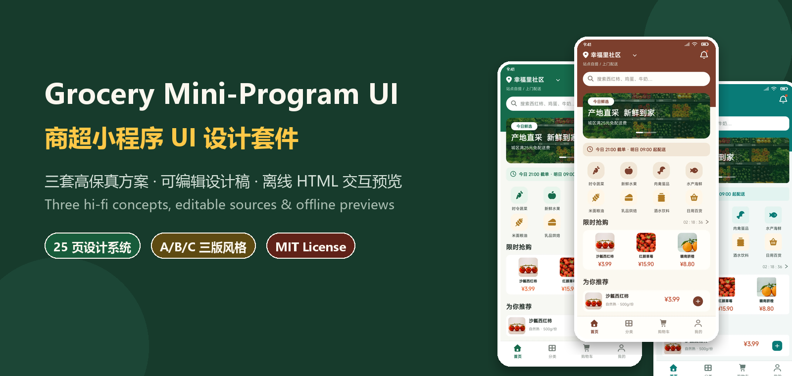
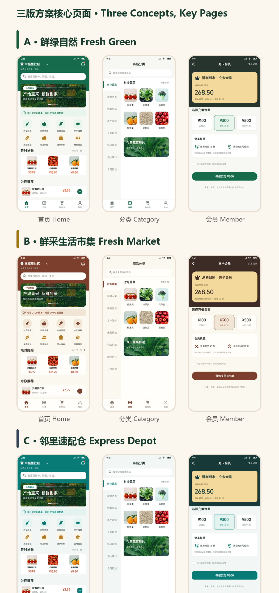

# 商超小程序 UI 设计 · Grocery Mini-Program UI

简体中文 | [English](README.md)



一个 Kimi 插件：为生鲜、商超、社区团购、即时零售与配送小程序设计**三套真正不同的高保真 UI 方案**，并交付可编辑设计稿、离线 HTML 交互预览和交付检查脚本。

## ✨ 功能特性

- **三套结构不同的方案，而非换色版本** —— 在信息密度、导航结构、商品陈列、图片比例、标题层级、促销表达、会员呈现、背景与形状语言等维度形成明显区别。
- **可编辑设计稿** —— `.kanva.pptd` 格式，覆盖 25 页设计系统（首页、分类、商品详情、购物车、结算、订单、会员、优惠券、售后等）。
- **离线 HTML 交互预览** —— 双击 `index.html` 即可打开，无需联网、无需部署；支持方案切换、页面目录、上一页/下一页、键盘方向键和 URL hash 定位。
- **交付检查脚本** —— `validate_delivery.py` 检查缺图、远程依赖、死按钮和未完成占位文字，检查通过后才交付。
- **中英文双语界面** —— 默认简体中文，内置英文语言包。

## 🎨 三套设计方向

| 版本 | 风格 | 侧重点 |
| --- | --- | --- |
| **A · 鲜绿自然** | 自然食材、清晰分区、舒展留白 | 新鲜感与配送效率 |
| **B · 鲜采生活市集** | 温润浅色背景、实物彩色品类、大图双列商品卡、强促销按钮、黑金会员 | 采购欲望与品质感 |
| **C · 邻里速配仓** | 深色配送信息头、较高信息密度、紧凑列表、快速复购 | 下单效率 |



## 📦 仓库结构

```
grocery-miniapp-ui/
├── kimi.plugin.json          # 插件清单
├── icon.svg                  # 插件图标
├── ASSET_NOTICES.md          # 第三方素材使用说明（商用前必读）
├── locales/
│   └── en-US.json            # 英文语言包（默认为简体中文）
├── commands/
│   └── grocery-miniapp-ui.md # 斜杠命令入口
├── skills/
│   └── grocery-miniapp-ui/
│       ├── SKILL.md                  # 设计工作流与交付规则
│       ├── references/
│       │   └── design-system.md      # 设计规范参考
│       └── scripts/
│           └── validate_delivery.py  # 交付检查脚本
├── assets/
│   ├── editable-designs/     # 三套可编辑 .kanva.pptd 设计稿（各 25 页）
│   └── html-preview/         # 离线 HTML 预览模板与示例包（zip）
└── docs/images/              # README 配图
```

## 🚀 安装

1. 将本仓库复制到 Kimi 插件目录，例如 `plugins/managed/grocery-miniapp-ui/`。
2. 重启 Kimi Work（或重载插件），插件显示为 **商超小程序 UI 设计 / Grocery Mini Program UI**。

## 💬 试用示例

- `为社区生鲜店设计三版小程序 UI`
- `按鲜采生活市集风格改版首页和会员页`
- `生成三版可离线打开的 HTML 交互预览`
- `Design three UI concepts for a community grocery mini program`

默认交付：390 × 844 移动端画布；A/B/C 三版方向；首页、分类、商品详情、购物车、结算、订单、个人中心、会员等核心页面，可扩展为完整 25 页；可编辑 `.kanva.pptd` 与三版离线 HTML 预览。

## ✅ 交付检查

```bash
python3 scripts/validate_delivery.py <交付目录>
```

检查失败必须修复后再交付。最终 HTML 预览必须离线可用，所有资源使用相对路径。

## ⚠️ 素材说明

`assets/` 中的参考设计使用过外部商品图片、Font Awesome 图标和 MiSans 字体，仅用于演示布局与组件尺度；插件许可**不**自动覆盖这些演示素材。用于商业项目时，请替换为客户自有或已确认授权的素材。详见 [ASSET_NOTICES.md](ASSET_NOTICES.md)。

## 📄 许可证

[MIT](LICENSE) © 2026 Dr. Shi
